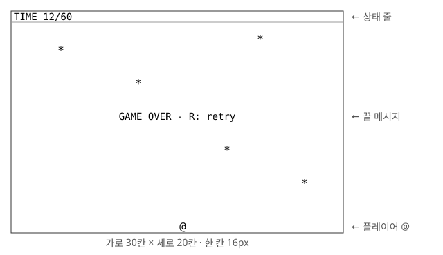
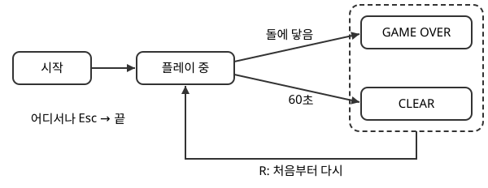

# 피하기 게임 — 기획설계문서 (v1.0)

> 플랫폼: Windows · C# 콘솔 앱 · 키보드 (이 실습에서 고정)

## 1. [한 줄 소개]
위에서 떨어지는 장애물들을 방향키로 피하는 게임 

## 2. [최종 목표]
 장애물에 부딪혀서 하트 다 깎이면 (Game Over) /
 장애물 피하면서 최대한 오래 버티기
## 3. [기본 규칙]
1. 화면은 가로 40칸 × 세로 60칸. 플레이어 `ㅇ`는 맨 아래 줄 가운데에서 시작한다.

2. ←/→ 키를 누를 때마다 한 칸 움직인다. 누르고 있으면 키 반복으로 계속 움직인다. 화면 밖으로는 나갈 수 없다.

3. 돌 `*`은 2초마다 맨 윗줄의 무작위 칸에 하나 생겨 초당 10칸 떨어진다.  
  (떨어지는 속도를 칸 수 말고 수치로 10초마다 점점 빨라지게 설정, 속도 숫자로 대입했을때 어느정도 속돈지 몰라서 수치는 임의로 7.0f; 로 설정)
  (장애물 생기는 시간도 10초마다 점점 줄어들게 설정 ex 2초 -> 1.9초 )

4. 돌이 `ㅇ`와 같은 칸에 5번 닿으면 패배(GAME OVER).
  (우측상단에 하트 5개 있고 장애물에 부딪힐때마다 하나씩 줄어들게 혹은 색 바뀌게)

5. 장애물에 부딪히게 되면 하트 1개 깎이고 0.5초간 무적(깜빡거림 or 원형막(보호)? 이펙트)

6. 버틴 시간을 맨 윗줄에 `TIME 01`처럼 초단위로 표시하고, 60초 이후엔 `TIME 1:01 ` 로 표시

7. 끝난 화면 (GAME OVER) 에서 R은 처음부터 다시. Esc는 일시정지 (일시정지 하면 게임종료 버튼 나오게) (구현 불가능하면 Esc는 바로 게임종료, Esc 한번 더 누르면 게임재개)

## 4. [조작]
| 키 | 동작 |
|---|---|
| ← / → | 왼쪽 / 오른쪽 한 칸 |
| R | 끝난 화면에서 다시 시작 |
| Esc | 일시정지 |

## [장애물 종류 및 특성]

[랜덤으로 나오지만 빈도 설정이 가능하다면 횟수는 장애물 20개당 번호순으로 1, 1, 1, 1, 5회]
1. 부딪혔을 때 방향키 좌우반전
2. 부딪혔을 때 시야 원모양으로 줄어듬
3. 부딪혔을 때 0.5초간 조작불가능
4. 부딪혔을 때 이동속도 1초간 -50%
5. 내려오는 속도 다른 장애물들에 비해 2배

## [이로운 효과]

1. 부딪혔을 때 2초간 무적 ( `ㅇ` 주위에 원형으로 막을 치든 효과의 지속시간동안 깜빡거려서 상태식별 가능하게 )
2. 부딪혔을 때 하트 하나 복구

### [ 모든 장애물과 효과들은 색이나 크기, 모양을 다르게 설정해서 구별이 용이하게 ex -> 빨주노초파남보]
### [사운드는 구현 가능성 보고 추후 논의]

## 5. 화면 구성

## 6. 게임 흐름

## 7. 만들지 않는 것
아이템, 난이도 단계

## 변경 이력
| 버전 | 날짜 | 바뀐 점 | PR |
|---|---|---|---|
| v1.0 | 2026-11-25 | 기초설정 | #1 |

