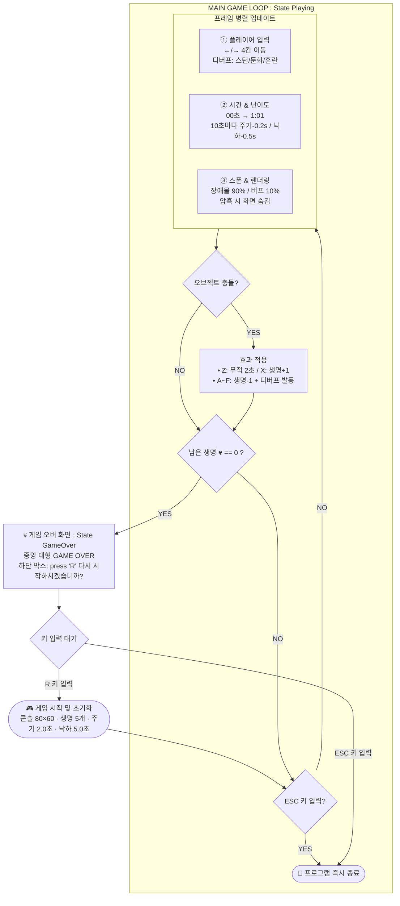

# 🎮 # 알파벳 피하기 게임 — 기획설계문서 (v2.0)

> 플랫폼: Windows · C# 콘솔 앱 · 키보드 (이 실습에서 고정)

## 1. 게임 개요
* **게임 제목:** 알파벳피하기
* **한 줄 소개:** 하늘에서 떨어지는 알파벳을 피해 최대한 오래 버텨라!

---

## 2. 화면 구성 (UI / UX)
* **콘솔 창 크기:** 세로 60 × 가로 80
* **플레이어 캐릭터:** `ㅁ` (화면 하단 배치)
* **상단 HUD (우측 상단):**
  * **생명 표시:** 하트 모양(`♥`)으로 5개 표시
  * **생존 시간:** 생명 표시 바로 아래에 배치 (게임 진행 중 자동 체크)
    * 시작 시 `00초` 형태로 표기
    * 60초 초과 시 `1:01` (분:초) 형태로 전환
* **게임 오버 화면:**
  * 중앙에 크게 `GAME OVER` 문구 출력
  * 바로 아래에 상대적으로 작은 크기로 `press 'R' 다시 시작하시겠습니까?` 안내 문구 출력

---

## 3. 조작법
* **이동:** 좌(`←`), 우(`→`) 방향키
  * **단발 입력:** 1회 입력 시 4칸 이동
  * **연속 입력:** 키를 꾹 누르고 있을 경우 연속 이동 가능
* **재시작:** 게임 오버 화면에서 `R` 키 입력
* **게임종료:** [ESC]키 입력시 게임 즉시 종료 

---

## 4. 게임 규칙 및 난이도 밸런스
* **승리 및 패배 조건:**
  * **승리(목표) 조건:** 별도의 클리어 엔딩이 없는 **무한 생존(하이스코어) 방식**으로, 하트(생명)가 모두 소모될 때까지 게임이 계속 진행되며 경과 시간이 자동으로 기록됨
  * **패배(종료) 조건:** 보유한 하트(생명)가 0개가 되어 모두 소모될 경우 즉시 패배 및 게임 오버
* **생명 시스템:** 초기 생명 5개 지급, 해로운 장애물 피격 시 생명 1개 차감, 차감 시 줄어드는 예시 : `♥ ♥ ♥ ♥ ♥` -> `♥ ♥ ♥ ♥`
* **장애물 스폰 및 낙하 규칙 (초기값):**
  * **생성 주기:** 2.0초 간격으로 화면 상단(하늘)에서 랜덤 X좌표에 생성
  * **낙하 속도:** 생성 후 바닥에 닿기까지 5.0초 소요
* **난이도 상승 및 상한선 (시간 경과):**
  * **생성 주기 감소:** 매 7초마다 `0.2초` 감소 (**최소 `0.3초` 제한**, 시작 후 59.5초 시점 도달)
  * **낙하 시간 감소:** 매 8.5초마다 `0.5초` 감소 (**최소 `1.5초` 제한**, 시작 후 59.5초 시점 도달)

---

## 5. 오브젝트 상세 (장애물 및 버프)
* **전체 스폰 비율:** 해로운 장애물 `88%` : 버프 아이템 `12%`

### 🟥 디버프 장애물 (피격 시 생명 -1 및 디버프 효과 부여)
* **공통 색상 규칙:** 콘솔 앱에서 구현 가능한 **어두운 계열 색상** 적용 (예: 보라색, 회색, 어두운 빨강/파랑 등)

| 모양 | 이름 | 권장 색상 | 스폰 확률 | 피격 시 추가 효과 (디버프) | 지속 시간 |
| :---: | :---: | :---: | :---: | :--- | :---: |
| `[A]` | 일반 알파벳 | 흰색(White) | 40% | 특별한 추가 효과 없음 (생명만 차감) | - |
| `[B]` | 스턴 알파벳 | 노란색(Yellow) | 8% | 플레이어 조작 불가능 | 0.5초 |
| `[C]` | 암흑 알파벳 | 회색(Gray) | 7% | 게임 화면 전체가 보이지 않음 | 0.3초 |
| `[D]` | 둔화 알파벳 | 진한 시안색(DarkCyan) | 10% | 플레이어 이동 속도 절반으로 감소 (2칸 이동) | 0.5초 |
| `[E]` | 혼란 알파벳 | 녹색(Green) | 8% | 좌/우 방향키 조작이 반대로 반전 | 1.0초 |
| `[F]` | 빠른 알파벳 | 흰색(White) | 15% | 바닥까지 떨어지는 속도가 다른 알파벳 대비 50% 빠름 | - |


### 🟦 버프 장애물 (피격 시 버프 효과 부여)
* **공통 색상 규칙:** 콘솔 앱에서 구현 가능한 **밝은 계열 색상** 적용 (단, 회복 알파벳은 예외적으로 빨간색 적용)

| 모양 | 이름 | 색상 | 스폰 확률 | 피격 시 효과 | 지속 시간 |
| :---: | :---: | :---: | :---: | :--- | :---: |
| `[Z]` | 무적 알파벳 | 파란색(Blue) | 7% | 모든 해로운 장애물에 대한 무적 판정<br>*(식별을 위해 캐릭터가 깜빡거림)* | 1.5초 |
| `[X]` | 회복 알파벳 | 빨간색(Red) | 5% | 차감된 생명 1개 복구<br>*(최대 생명 5개 상태일 경우 효과 없음)* | 즉시 발동 |

## 6. 화면 배치도 및 게임 흐름도

### 🖼️ 화면 배치도 (80 × 60 콘솔 기준)

#### ① 인게임 플레이 화면 (`State: Playing`)
```text
+------------------------------------------------------------------------------+ (Y=0)

|                                                                ♥ ♥ ♥ ♥ ♥     | (Y=1: 생명 HUD)
|                                                                     1:05     | (Y=2: 생존 시간)
|      [A]                                                                     | (Y=3~57: 낙하 영역)
|                                      [F]                                     |
|                                                                              |
|                        [Z]                                                   |
|                                                                              |
|                                                    [C]                       |
|                                                                              |
|                                    ㅁ                                        | (Y=58: 플레이어)
+------------------------------------------------------------------------------+ (Y=59: 바닥)
(X=0)                                                                       (X=79)
```

#### ② 게임 오버 화면 (`State: GameOver`)
```text
+------------------------------------------------------------------------------+ (Y=0)

|                                                                              |
|                                                                              |
|         ████    ███   █   █  █████       ███   █   █  █████  ████            |
|        █       █   █  ██ ██  █          █   █  █   █  █      █   █           |
|        █  ███  █████  █ █ █  ████       █   █  █   █  ████   ████            | (화면 중앙 상단)
|        █    █  █   █  █   █  █          █   █   █ █   █      █   █           |
|         ████   █   █  █   █  █████       ███     █    █████  █   █           |
|                                                                              |
|                                                                              |
|             ╔══════════════════════════════════════════════════╗             |
|             ║                                                  ║             |
|             ║   p r e s s  ' R '   다 시  시 작 하 시 겠 습 니 까 ?   ║             
|             ║                                                  ║             |
|             ╚══════════════════════════════════════════════════╝             |
|                                                                              |
|                                                                              |
+------------------------------------------------------------------------------+ (Y=59)
(X=0)                                                                       (X=79)
```

### 🖼️ 게임 흐름도


---

## 7. 구현가능한지 궁금한 것들 (코멘트 남겨주세요)
* **알파벳 색이 내려오면서 바뀔 수 있는지 (무드등마냥)**
* **시간이 지날수록 화면이 줄어드는 연출이 가능한지 (천장이 점점 내려오는 형태로)**

## 8. 만들지 않는 것
* **난이도 단계(STAGE)**

## 변경 이력
| 버전 | 날짜 | 바뀐 점 | PR |
|---|---|---|---|

| v1.0 | 2026-11-25 | 기초설정 | #1 |
| v1.1 | 2026-11-25 | 설정추가 및 조정 | #2 |
| v2.0 | 2026-11-25 | 기존설정 삭제 및 재설정 | #3 |
| v2.1 | 2026-11-26 | 장애물 색 설정 및 난이도 조정, 질문 추가 | #4 |